# ADLC evidence index

This is an implementation checkpoint, **not an operational-environment claim**.
Platform preflight, Web, Academics, Enrollments, shared compatibility controls,
personal-Copilot configuration and the runtime suite have reached protected
`main`. Students' initial PR is tracked below. No Azure resource or role has
been changed by this implementation; provisioning and teardown remain guarded.

## What has actually run

| Outcome | Evidence | Boundary |
| --- | --- | --- |
| Deterministic intent gate rejects incomplete stories even when code checks pass | [Negative draft PR](https://github.com/msft-contoso-university/contoso-engineering/pull/2) | Deliberately incomplete; do not merge or accept its story |
| Real GitHub Agentic Workflow reaches inference | [Triage run](https://github.com/msft-contoso-university/contoso-engineering/actions/runs/44133251141) | Initial execution returned HTTP 403; later native retry/cancel state is inconsistent, not successful triage or an AI loop |
| Students migrations and synthetic seed CLI execute against SQL Server | [SQL CI](https://github.com/msft-contoso-university/contoso-students/actions/runs/44142728540) | Candidate `201002068640b22ef0defe2312629e9725d4d287`; not Azure SQL |
| Academics SQL-backed HTTP/JWT tests, response contracts, dependency audit and portable packaging | [Core CI](https://github.com/msft-contoso-university/contoso-academics/actions/runs/44143517914) | Candidate `50757714b48a29198d9664aa7c2a2a8db4b9192c`; no live Entra |
| Academics extended CodeQL scans C#, Python and Actions with no findings | [Candidate analysis](https://github.com/msft-contoso-university/contoso-academics/actions/runs/44144521998) | Read-only SARIF evidence; not native registered alerts or release approval |
| Web portable build, consumer interactions, tests and dependency audit | [Core CI](https://github.com/msft-contoso-university/contoso-web/actions/runs/44143080591) | Candidate `38b43796784628ac72d8977b5097ec8d21f9f633`; APIs/identity not cloud-integrated |
| Academics actual SQL HTTP responses pass both mapped consumers | [Cross-repo CI](https://github.com/msft-contoso-university/contoso-academics/actions/runs/44149549431) | Same-run artifacts; pinned Web and Enrollments parsing; no live service calls |
| Enrollments actual SQL HTTP responses pass Web | [Cross-repo CI](https://github.com/msft-contoso-university/contoso-enrollments/actions/runs/44149555454) | Same-run artifacts; pinned consumer; no cloud integration claim |
| Students compatibility defect blocks aggregate despite passing producer tests and CodeQL | [Negative real gate](https://github.com/msft-contoso-university/contoso-students/actions/runs/44149698073) | Default enrollment date rejected by Web; retained as genuine negative evidence |
| Students producer invariant fixes the defect without changing frozen consumers | [Red-to-green CI](https://github.com/msft-contoso-university/contoso-students/actions/runs/44151844775) | Required dates, UTC responses, dirty-data migration refusal; original Web/Enrollments checks pass |
| Students source-bound portable ZIP | [Candidate CI](https://github.com/msft-contoso-university/contoso-students/actions/runs/44153337497) | Matching manifest and per-file/archive hashes; not promotion approval |
| Web source-bound portable ZIP | [Candidate CI](https://github.com/msft-contoso-university/contoso-web/actions/runs/44155173991) | Separate package/evidence artifacts; source/run/attempt-qualified upload |
| Academics portable ZIP and both consumers | [Candidate CI](https://github.com/msft-contoso-university/contoso-academics/actions/runs/44157058530) | Compiler paths normalized; private-path guard retained |
| Enrollments build-once native OCI candidate and Web consumer | [Candidate CI](https://github.com/msft-contoso-university/contoso-enrollments/actions/runs/44157059150) | Exact original OCI config/rootfs and all blob digests verified; no registry import |
| Web explicit App Service HTTPS boundary | [Hosting candidate CI](https://github.com/msft-contoso-university/contoso-web/actions/runs/44158620659) | HTTP-backed OIDC challenge preserves HTTPS, ignores spoofed forwarding headers and rejects unknown hosts; no live Azure proof |
| Four actual ASP.NET Core HTTP pipelines and three independent SQL databases pass the complete runtime journey and refusal cases | [Fresh runtime CI](https://github.com/msft-contoso-university/contoso-engineering/actions/runs/44184927026) | Head `dfa7b4b2ca49c344a707ec46defba5ac501beb66`, tested merge `50bb7bf7cf807a92244f2a108ea2aeced972b489`; downloaded TRX independently checked: seven passed, none skipped |
| Personal Copilot inference configuration and genuine compiled locks reach main | [Merged configuration](https://github.com/msft-contoso-university/contoso-engineering/pull/11) | Post-merge [strict compile](https://github.com/msft-contoso-university/contoso-engineering/actions/runs/44180956832) passed; this does not validate the token or prove inference |
| Real conversation-resolution protection blocks a setup merge despite green CI | [Students review](https://github.com/msft-contoso-university/contoso-students/pull/2#discussion_r4604089489) | Path handling was remediated with a focused regression; non-review protection was not waived |

These are historical runs bound to their exact commits. A later source or
workflow change needs its own current checks. PR CI may analyze a synthetic
merge commit rather than the contributor's head. Candidate artifacts are not
reviewed releases; platform promotion must bind to the exact approved source,
artifact identity and checksum.

## Source integration and review boundaries

| Surface | Evidence |
| --- | --- |
| Merged guarded platform preflight | [Platform PR 1](https://github.com/msft-contoso-university/contoso-platform/pull/1) |
| Merged Web implementation | [Web PR 2](https://github.com/msft-contoso-university/contoso-web/pull/2) |
| Merged Academics implementation | [Academics PR 2](https://github.com/msft-contoso-university/contoso-academics/pull/2) |
| Merged Enrollments implementation | [Enrollments PR 2](https://github.com/msft-contoso-university/contoso-enrollments/pull/2) |
| Students implementation and review remediation | [Students PR 2](https://github.com/msft-contoso-university/contoso-students/pull/2) |
| Merged shared compatibility controls | [Engineering PR 7](https://github.com/msft-contoso-university/contoso-engineering/pull/7) |
| Merged real four-service runtime suite | [Engineering PR 9](https://github.com/msft-contoso-university/contoso-engineering/pull/9) |
| Merged personal-Copilot configuration | [Engineering PR 11](https://github.com/msft-contoso-university/contoso-engineering/pull/11) |

Enrollments' hosted candidate runs SQL, contract, audit and native OCI checks;
use that PR's actual current checks for the exact run and commit. A candidate
has not satisfied the intent gate merely because its technical checks pass.
Initial intent acceptance was explicitly maintainer-directed and transparently
recorded as delegated execution; the label audit cannot prove who physically
controlled the credential.

The maintainer separately authorized a **temporary, initial-setup review-only
exception**, not an independent approval. Each protected merge checked the exact
head and successful required CI, saved the full policy, temporarily changed only
approval count/codeowner/latest-push review selectors, then restored and compared
the complete original policy before another merge. Strict app-qualified checks,
admin enforcement and conversation resolution stayed active. Native rejection
also restored protection. Inline findings were investigated and addressed or
resolved with source-specific justification, not hidden by weakening that gate.

Ordinary review protection is restored. A PR author cannot supply their own
required GitHub approval. The codeowner flag only designates an owner where
CODEOWNERS actually exists; platform still has no designated owner mapping.
Source integration and this bootstrap exception do not approve artifacts,
cloud deployment, identity grants or incident remediation.

## Intended delivery and runtime path

The Azure boxes and incident loop below are **planned, not deployed**.

```mermaid
flowchart LR
  goal[Human goal and acceptance] --> issue[Structured issue]
  issue --> agent[Bounded proposed implementation]
  agent --> pr[Linked PR]
  pr --> gate[Tests / contracts / scanners]
  gate --> review[Independent human review]
  review -. not promoted .-> platform[Platform-owned immutable release]
  platform -. not deployed .-> web[Web: App Service]
  web -. delegated tokens .-> students[Students: App Service]
  web -. delegated tokens .-> academics[Academics: App Service]
  web -. delegated tokens .-> enrollments[Enrollments: Container Apps]
  enrollments -. least-privilege app lookup .-> students
  enrollments -. least-privilege app lookup .-> academics
  students -. owned database .-> sdb[(Students SQL)]
  academics -. owned database .-> adb[(Academics SQL)]
  enrollments -. owned database .-> edb[(Enrollments SQL)]
  web -. traces .-> insights[Application Insights]
  students -. traces .-> insights
  academics -. traces .-> insights
  enrollments -. traces .-> insights
  insights -. not connected .-> sre[SRE Agent: Review mode]
  sre -. incident evidence / proposed action .-> approval[Human operational approval]
  approval -. verified recovery / regression story .-> issue
```

Producer CI now executes the mapped consumer candidates using the producer's
actual HTTP response artifacts from the same run, SHA and attempt. The shared
workflow freezes consumer source pins, runs real parsing/mapping, and rejects
missing or zero/skipped/failed TRX evidence. It has only contents/Actions read
permissions and inherits no secrets.

The first Students execution exposed a meaningful defect: an omitted enrollment
date became `0001-01-01T00:00:00`, which the Web client correctly rejected even
though producer unit tests and static analysis passed. The aggregate blocked the
candidate. The supported fix is an explicit producer date invariant with a
regression test, not removal of the consumer check or substitution of the bad
sample. [The fix run](https://github.com/msft-contoso-university/contoso-students/actions/runs/44151844775)
passes both original frozen consumers after requiring nondefault dates, emitting
UTC-designated responses and adding the SQL constraint. Its regression tests also
exercise dirty-data migration refusal: no stored date is silently fabricated.
That historical failure and repair remain separate from later maintainer-directed
intent acceptance and the explicitly authorized source-bootstrap exception.
Green push CI is not independent review or release approval.

Those consumer checks validate offline payload compatibility. The separate runtime
suite exercises actual Web forms, antiforgery/cookies, service authorization and
database persistence through four in-process TestServer HTTP pipelines and three
real SQL Server databases. Test-only issuer/credential adapters do not bypass the
production authorization policies. It also checks reader/app-only/wrong-audience
refusals, missing references and visible upstream failure without persistence.
`Runtime integration gate` is now an app-qualified required check on engineering
`main`, added only after that exact check passed on the actual merged main commit;
the existing CI, strictness, review, admin and conversation controls were preserved.
Its frozen source combination is not automatic full-stack validation of every
later producer commit. Neither suite proves live Entra, private Azure connectivity,
separate deployed processes or distributed Application Insights traces.
Student deletion is also not legacy-equivalent: no cross-service cascading
deletion or invented retention policy has been implemented.

The candidate packaging interface is now shared across the applications:
`untrusted-candidate-<sha>-<run-id>-<attempt>`. App Service packages have a
root-level portable ZIP, matching embedded/external `candidate.json` and
`SHA256SUMS`; Enrollments has a native OCI archive, manifest, checksums and
migration SQL. The first package checks rejected private compiler paths and
Docker-to-OCI config rewriting. The fixes normalize compilation and build OCI
natively rather than excluding evidence or accepting changed image identity.
Artifact-reported hashes only establish consistency. Independent promotion
authorization, trusted provenance, protected private transfer and registry import
are separate, still-incomplete controls.

Web has an explicit, fail-closed App Service TLS-termination contract:
`Hosting__AppServiceHttpsOnly=true`, native site `httpsOnly: true`,
`ASPNETCORE_FORWARDEDHEADERS_ENABLED=false` and one `AllowedHosts` value matching
native `WEBSITE_HOSTNAME`. It normalizes the worker request scheme before
HSTS/redirect/authentication without trusting `X-Forwarded-*` or arbitrary proxy
networks. This is safe only when App Service is the sole worker ingress.
Platform configuration now declares the same contract, but native readback,
external HTTP-to-HTTPS behavior and exclusive ingress remain release blockers.

## Open consequential gates

1. Prove real gh-aw inference. Main now uses explicitly selected personal
   `copilot-requests: none` bindings and an inherited organization Actions secret.
   The [single personal pilot](https://github.com/msft-contoso-university/contoso-engineering/actions/runs/44172504634)
   remains queued with zero jobs and inconsistent native cancellation responses.
   Token validity, entitlement and successful inference are unverified. All three
   inference workflows remain manually paused; no duplicate dispatch, unapproved
   identity/provider change or paid-overage authorization is implied.
2. Keep normal intent and independent-review controls enabled for the realistic
   rehearsal. Initial source-bootstrap delegation was exceptional and recorded,
   not a fabricated independent approval or permission to weaken release gates.
3. Finish the platform composition, identity configuration and immutable
   promotion. SQL grants must verify the exact managed-identity client-ID SID
   and principal type, never accept an existing principal by display name alone.
   The private grant executor remains blocked pending Azure SQL verification.
4. Complete Azure prepare/validate/approved what-if before deployment. An
   implementation-region assumption is not a recorded user-selected region.
   No broad subscription-level SRE role grant has been approved.
5. Demonstrate private migrations, live Entra authorization, real telemetry,
   actual SRE repository/incident connectors and bounded recovery. Source tags
   or configuration files alone do not prove these data-plane connections.
6. Exercise fresh creation, repeat update, partial-failure recovery, explicitly
   scoped teardown and recreation through the same platform-owned lifecycle.
   Keep GitHub evidence; verify SRE deletion rather than merely stopping it.
7. Complete the original native automation import. The existing automation and
   original application repository remain preserved; native Windows `gh aw add`
   startup hangs and an authenticated source lookup encountered SAML enforcement.
   No conversion, push or successful execution of that original automation is
   claimed, and no authorization boundary was bypassed.

## Methodology and research boundary

The implementation applies human-owned intent, bounded agent authority,
deterministic evidence, independently reviewed changes and verified operational
feedback. These are original implementation choices, not a copied handbook.

The complete 32-page published
[Agentic SDLC Handbook](https://danielmeppiel.github.io/agentic-sdlc-handbook/)
was captured privately for research at source revision
`de33de2c84a55552da256153c55984e0068beb70`, with its license and source manifest.
Its CC BY-NC-ND originals are not redistributed here. Other research inputs
include [Anthropic's engineering guidance](https://www.anthropic.com/engineering),
[Kiro specifications](https://kiro.dev/docs/specs/),
[Google Conductor](https://github.com/gemini-cli-extensions/conductor),
[Spec Kit](https://github.com/github/spec-kit) and
[GitHub Agentic Workflows galleries](https://github.github.com/gh-aw/gallery/).
The EPAM article could only be reviewed through indexed excerpts; direct access
was denied, so it is not represented as a complete capture.
