# ADLC evidence index

This is an implementation checkpoint, **not an operational-environment claim**.
All application changes below remain unmerged candidates. No Azure resource or
role has been changed by this implementation.

## What has actually run

| Outcome | Evidence | Boundary |
| --- | --- | --- |
| Deterministic intent gate rejects incomplete stories even when code checks pass | [Negative draft PR](https://github.com/msft-contoso-university/contoso-engineering/pull/2) | Deliberately incomplete; do not merge or accept its story |
| Real GitHub Agentic Workflow reaches inference | [Triage run](https://github.com/msft-contoso-university/contoso-engineering/actions/runs/44133251141) | HTTP 403; not a successful triage or AI loop |
| Students migrations and synthetic seed CLI execute against SQL Server | [SQL CI](https://github.com/msft-contoso-university/contoso-students/actions/runs/44142728540) | Candidate `201002068640b22ef0defe2312629e9725d4d287`; not Azure SQL |
| Academics SQL-backed HTTP/JWT tests, response contracts, dependency audit and portable packaging | [Core CI](https://github.com/msft-contoso-university/contoso-academics/actions/runs/44143517914) | Candidate `50757714b48a29198d9664aa7c2a2a8db4b9192c`; no live Entra |
| Academics extended CodeQL scans C#, Python and Actions with no findings | [Candidate analysis](https://github.com/msft-contoso-university/contoso-academics/actions/runs/44144521998) | Read-only SARIF evidence; not native registered alerts or release approval |
| Web portable build, consumer interactions, tests and dependency audit | [Core CI](https://github.com/msft-contoso-university/contoso-web/actions/runs/44143080591) | Candidate `38b43796784628ac72d8977b5097ec8d21f9f633`; APIs/identity not cloud-integrated |
| Academics actual SQL HTTP responses pass both mapped consumers | [Cross-repo CI](https://github.com/msft-contoso-university/contoso-academics/actions/runs/44149549431) | Same-run artifacts; pinned Web and Enrollments parsing; no live service calls |
| Enrollments actual SQL HTTP responses pass Web | [Cross-repo CI](https://github.com/msft-contoso-university/contoso-enrollments/actions/runs/44149555454) | Same-run artifacts; pinned consumer; no cloud integration claim |
| Students compatibility defect blocks aggregate despite passing producer tests and CodeQL | [Negative real gate](https://github.com/msft-contoso-university/contoso-students/actions/runs/44149698073) | Default enrollment date rejected by Web; producer fix pending, not a harness bypass |

These are historical runs bound to their exact commits. A later source or
workflow change needs its own current checks. PR CI may analyze a synthetic
merge commit rather than the contributor's head. Candidate artifacts are not
reviewed releases; platform promotion must bind to the exact approved source,
artifact identity and checksum.

## Review surfaces

- [Web draft PR](https://github.com/msft-contoso-university/contoso-web/pull/2)
- [Academics draft PR](https://github.com/msft-contoso-university/contoso-academics/pull/2)
- [Enrollments draft PR](https://github.com/msft-contoso-university/contoso-enrollments/pull/2)
- [Students draft PR](https://github.com/msft-contoso-university/contoso-students/pull/2)
- [Shared compatibility gate draft PR](https://github.com/msft-contoso-university/contoso-engineering/pull/7)

The Enrollments worker reports SQL, contract, audit and Docker checks passed;
use that PR's actual current checks for the exact run and commit. A candidate
has not satisfied the intent gate merely because its technical checks pass.
No application story has been accepted by an agent. Only a human writer can
accept intent, and the latest push still requires independent human review.
A PR author cannot provide their own required GitHub approval. The configured
codeowner requirement only becomes effective once an actual CODEOWNERS policy
exists on the trusted default branch; setting the flag alone does not establish
an independent owner or close the first-bootstrap policy gap.

## Intended delivery and runtime path

The Azure boxes and incident loop below are **planned, not deployed**.

```mermaid
flowchart LR
  goal[Human goal and acceptance] --> issue[Structured issue]
  issue -. authorization pending .-> agent[Agent implementation]
  agent --> pr[Linked PR]
  pr --> gate[Tests / contracts / scanners]
  gate --> review[Independent human review]
  review -. not promoted .-> platform[Platform-owned immutable release]
  platform -. not deployed .-> web[Web: App Service]
  web -. delegated tokens .-> students[Students: App Service]
  web -. delegated tokens .-> academics[Academics: App Service]
  web -. delegated tokens .-> enrollments[Enrollments: Container Apps]
  enrollments -. least-privilege app lookup .-> students
  enrollments -. least-privilege app lookup .-> academics
  students -. owned database .-> sdb[(Students SQL)]
  academics -. owned database .-> adb[(Academics SQL)]
  enrollments -. owned database .-> edb[(Enrollments SQL)]
  web -. traces .-> insights[Application Insights]
  students -. traces .-> insights
  academics -. traces .-> insights
  enrollments -. traces .-> insights
  insights -. not connected .-> sre[SRE Agent: Review mode]
  sre -. incident evidence / proposed action .-> approval[Human operational approval]
  approval -. verified recovery / regression story .-> issue
```

Producer CI now executes the mapped consumer candidates using the producer's
actual HTTP response artifacts from the same run, SHA and attempt. The shared
workflow freezes consumer source pins, runs real parsing/mapping, and rejects
missing or zero/skipped/failed TRX evidence. It has only contents/Actions read
permissions and inherits no secrets.

The first Students execution exposed a meaningful defect: an omitted enrollment
date became `0001-01-01T00:00:00`, which the Web client correctly rejected even
though producer unit tests and static analysis passed. The aggregate blocked the
candidate. The supported fix is an explicit producer date invariant with a
regression test, not removal of the consumer check or substitution of the bad
sample. The green fix run must be linked before claiming this defect resolved.

These are offline payload checks. Local stubs, contract fixtures and SQL Server
containers are not evidence of private Azure connectivity or distributed traces.
Student deletion is also not legacy-equivalent: no cross-service cascading
deletion or invented retention policy has been implemented.

## Open consequential gates

1. Establish valid gh-aw inference authorization. The first provider request was
   denied; no successful triage, automated review or cloud-agent goal-to-PR loop
   is claimed. Inference workflows stay natively paused; do not substitute
   credentials, accounts or providers to get around the denial.
2. Obtain actual human story acceptance and independent review. Preserve native
   branch protection, stale-review dismissal and last-push approval.
3. Finish the platform composition, identity configuration and immutable
   promotion. SQL grants must verify the exact managed-identity client-ID SID
   and principal type, never accept an existing principal by display name alone.
   The private grant executor remains blocked pending Azure SQL verification.
4. Complete Azure prepare/validate/approved what-if before deployment. An
   implementation-region assumption is not a recorded user-selected region.
   No broad subscription-level SRE role grant has been approved.
5. Demonstrate private migrations, live Entra authorization, real telemetry,
   actual SRE repository/incident connectors and bounded recovery. Source tags
   or configuration files alone do not prove these data-plane connections.
6. Exercise fresh creation, repeat update, partial-failure recovery, explicitly
   scoped teardown and recreation through the same platform-owned lifecycle.
   Keep GitHub evidence; verify SRE deletion rather than merely stopping it.

## Methodology and research boundary

The implementation applies human-owned intent, bounded agent authority,
deterministic evidence, independently reviewed changes and verified operational
feedback. These are original implementation choices, not a copied handbook.

The complete 32-page published
[Agentic SDLC Handbook](https://danielmeppiel.github.io/agentic-sdlc-handbook/)
was captured privately for research at source revision
`de33de2c84a55552da256153c55984e0068beb70`, with its license and source manifest.
Its CC BY-NC-ND originals are not redistributed here. Other research inputs
include [Anthropic's engineering guidance](https://www.anthropic.com/engineering),
[Kiro specifications](https://kiro.dev/docs/specs/),
[Google Conductor](https://github.com/gemini-cli-extensions/conductor),
[Spec Kit](https://github.com/github/spec-kit) and
[GitHub Agentic Workflows galleries](https://github.github.com/gh-aw/gallery/).
The EPAM article could only be reviewed through indexed excerpts; direct access
was denied, so it is not represented as a complete capture.
